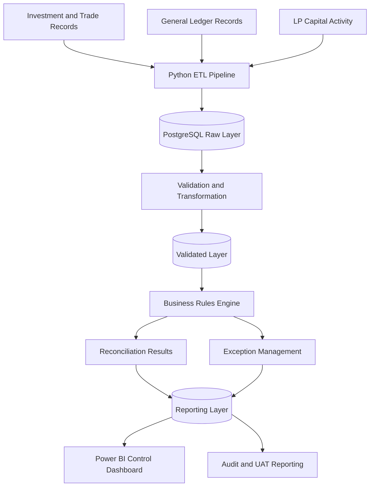

# Fund Accounting Data Quality & Reconciliation Platform

**An end-to-end financial data quality, reconciliation, and exception management framework built using Python, SQL, PostgreSQL, and Power BI.**

> **Project Status:** In Progress  
> **Data Classification:** 100% Synthetic Data  
> **Domain:** Fund Accounting | Financial Data Operations | Data Engineering | Data Quality

## 1. Overview

The Fund Accounting Data Quality & Reconciliation Platform is a data engineering and financial controls project designed to improve the accuracy, consistency, and traceability of fund accounting data.

The platform simulates a private credit fund's financial data environment using three synthetic source systems:

- Investment and trade records
- General ledger (GL) and fund administrator records
- Limited Partner (LP) capital activity

It will ingest financial records, validate them against predefined business rules, reconcile financial balances, identify exceptions, and expose reliable reporting data through a Power BI dashboard.

The project follows the complete data control lifecycle:

**Data Ingestion → Validation → Reconciliation → Exception Management → Review and Approval → Reporting**

All records will be generated for demonstration and testing purposes. No real investor, fund, or financial institution data will be used.

## 2. Objectives

- Develop an automated framework for financial data validation and reconciliation.
- Implement configurable business rules with severity levels and acceptance criteria.
- Identify discrepancies between investment records and general ledger balances.
- Validate Net Asset Value (NAV) calculations and LP capital allocations.
- Track exceptions, ownership, ageing, and resolution status.
- Maintain data lineage, auditability, and source-to-report traceability.
- Build a Power BI dashboard for monitoring financial controls and data quality.
- Test the framework using deliberately injected data errors.

## 3. Key Features

The following features represent the planned project scope.

| Feature | Description |
|---|---|
| Synthetic Data Generation | Generate investment, GL, and LP capital activity records using Python. |
| Layered Data Architecture | Separate raw, validated, and reporting datasets in PostgreSQL. |
| Business Rules Catalogue | Maintain 25 proposed financial and data quality rules. |
| Reconciliation Engine | Compare balances and identify financial discrepancies. |
| Exception Management | Record failures, severity, timestamps, owners, and resolution status. |
| Exception Ageing | Calculate how long an exception has remained unresolved. |
| Data Lineage | Document the movement of data from source systems to reporting. |
| Audit Trail | Maintain batch execution history and exception status changes. |
| Power BI Reporting | Visualize rule pass rates, NAV movements, and outstanding exceptions. |
| UAT Testing | Verify that known defects are detected and valid records pass. |

## 4. Technology Stack

| Technology | Purpose |
|---|---|
| Python | Data generation, ETL orchestration, validation, and reconciliation logic |
| Pandas and NumPy | Synthetic dataset creation and data manipulation |
| PostgreSQL | Storage for raw, validated, and reporting datasets |
| SQL | Data transformations, reconciliation queries, and reporting tables |
| Power BI | Financial controls dashboard and KPI reporting |
| DAX | Dashboard measures and analytical calculations |
| Git and GitHub | Version control and project documentation |
| Mermaid | Architecture, process flows, and data lineage diagrams |
| pytest | Automated testing of validation and reconciliation logic |

## 5. System Architecture



### Data Flow

1. Generate synthetic financial records for a fictional private credit fund.
2. Load the source datasets into PostgreSQL.
3. Preserve the original ingested records in the raw layer.
4. Apply data type checks, integrity checks, and business validations.
5. Execute financial reconciliation and accounting rules.
6. Store rule results and exceptions with relevant audit information.
7. Publish curated reporting tables for Power BI.
8. Test the results against expected outcomes using UAT scenarios.

## 6. Data Sources

### 6.1 Investment and Trade Records

Represents the fund's investment positions and transactions.

Example fields:

- `investment_id`
- `fund_id`
- `transaction_id`
- `transaction_date`
- `investment_type`
- `currency`
- `principal_amount`
- `fair_value`
- `interest_accrual`
- `valuation_date`

### 6.2 General Ledger and Administrator Extract

Represents accounting balances and financial movements.

Example fields:

- `gl_transaction_id`
- `fund_id`
- `account_code`
- `account_type`
- `posting_date`
- `debit_amount`
- `credit_amount`
- `currency`
- `accounting_period`

### 6.3 LP Capital Activity

Represents capital calls, distributions, and investor ownership.

Example fields:

- `lp_id`
- `fund_id`
- `activity_id`
- `activity_type`
- `activity_date`
- `capital_call_amount`
- `distribution_amount`
- `ownership_percentage`

The exact schemas will be finalized during implementation. All monetary fields, identifiers, dates, and financial assumptions will be documented in the data dictionary.

## 7. Database Design

The PostgreSQL database will use three logical layers.

### Raw Layer

Schema: `raw`

Stores source records as ingested, including source identifiers, batch IDs, and ingestion timestamps.

Proposed tables:

- `raw.investment_positions`
- `raw.gl_transactions`
- `raw.lp_activity`

### Validated Layer

Schema: `validated`

Contains standardized and validated records ready for downstream processing.

Planned checks include:

- Required fields and data types
- Duplicate transaction detection
- Referential integrity
- Valid dates and reporting periods
- Currency and valuation completeness

### Reporting Layer

Schema: `reporting`

Contains curated data designed for reconciliation reporting and Power BI.

Proposed tables:

- `reporting.dim_fund`
- `reporting.dim_investment`
- `reporting.dim_lp`
- `reporting.fact_rule_results`
- `reporting.fact_exceptions`
- `reporting.fact_nav_rollforward`

Supporting tables will capture rule definitions, execution batches, and exception history.

## 8. Business Rules Catalogue

The project will define 25 rules across five categories.

| Category | Planned Rules | Example |
|---|---:|---|
| Financial Reconciliation | 6 | Investment positions reconcile to GL balances |
| LP Capital Accounting | 5 | Ownership totals and allocations reconcile |
| Data Integrity | 5 | Duplicate transactions and broken identifiers |
| Valuation and Cut-off | 5 | Stale valuations and missing FX rates |
| Fees and Controls | 4 | Management fee calculations and approval status |
| **Total** | **25** | |

Each rule will include:

- Rule ID and name
- Business description
- Category and severity
- Business owner
- Validation logic
- Tolerance, where applicable
- Acceptance criteria
- Execution result
- Exception details

### Example Rule: NAV Roll-forward

The NAV roll-forward control checks whether the closing Net Asset Value agrees with the opening NAV and the period's financial movements.

```text
Closing NAV =
    Opening NAV
    + Contributions
    - Distributions
    + Income and Gains
    - Fees and Expenses
```

**Expected behavior:** The calculated closing NAV must agree with the reported closing NAV within the configured tolerance.

**Failure behavior:** A discrepancy generates an exception containing the fund, reporting period, expected value, reported value, variance, rule ID, severity, and execution timestamp.

Other planned rules include investment-to-GL reconciliation, cash balance checks, LP allocation validation, duplicate detection, missing FX rate checks, valuation freshness, and transaction cut-off validation.

Accounting sign conventions, tolerance thresholds, and fee calculation bases will be explicitly defined rather than assumed.

## 9. Exception Management

The exception engine will maintain a structured record of each detected control failure.

Proposed exception attributes:

- `exception_id`
- `rule_id`
- `fund_id`
- `reporting_period`
- `severity`
- `expected_value`
- `actual_value`
- `variance_amount`
- `detected_at`
- `assigned_owner`
- `status`
- `resolved_at`

The framework will support exception ageing, severity-based prioritization, and resolution history.

Proposed severity levels:

- **Critical:** Material financial reconciliation or NAV discrepancy.
- **High:** Significant accounting or allocation inconsistency.
- **Medium:** Data quality issue requiring investigation.
- **Low:** Non-critical validation or documentation issue.

Actual severity assignments will be defined in the business rules catalogue. Exception resolution and approval will be implemented as a documented workflow, not treated as an automatic consequence of a successful validation run.

## 10. Power BI Dashboard

Three dashboard pages are planned.

### Page 1: Control Overview

- Total rules executed
- Passed and failed rule counts
- Rule pass rate
- Open exceptions by severity
- Data quality trends across reporting periods

### Page 2: NAV and Reconciliation

- Opening and closing NAV
- Contributions and distributions
- Income, gains, fees, and expenses
- Investment-to-GL variances
- Reconciliation results by fund and reporting period

### Page 3: Exception Management

- Open exceptions by rule and severity
- Exception ageing buckets
- Assigned owner and resolution status
- Exception details and historical trends

Dashboard measures will be calculated from the curated reporting layer. The initial implementation will use synthetic data and clearly defined reporting assumptions.

## 11. Repository Structure

```text
fund-accounting-data-quality/
├── config/
├── data/
│   ├── synthetic/
│   └── generated/
├── docs/
│   ├── BRD.md
│   ├── business_rules.md
│   ├── process_design.md
│   ├── data_dictionary.md
│   ├── data_lineage.md
│   └── UAT_test_cases.md
├── powerbi/
├── sql/
│   ├── schemas/
│   ├── transformations/
│   └── reporting/
├── src/
│   ├── generators/
│   ├── ingestion/
│   ├── validations/
│   ├── reconciliation/
│   └── exceptions/
├── tests/
│   ├── unit/
│   └── uat/
├── .env.example
├── .gitignore
├── requirements.txt
└── README.md
```

## 12. Getting Started

The following setup describes the intended local development environment. Commands that reference future scripts will become executable as those components are implemented.

### Prerequisites

- Python 3.11 or a compatible supported version
- PostgreSQL
- Git
- Power BI Desktop for dashboard development

### Step 1: Clone the Repository

```bash
git clone <YOUR_GITHUB_REPOSITORY_URL>
cd fund-accounting-data-quality
```

Replace the placeholder URL with the repository's actual URL.

### Step 2: Create a Virtual Environment

**Windows:**

```powershell
python -m venv .venv
.venv\Scripts\Activate.ps1
```

**macOS/Linux:**

```bash
python3 -m venv .venv
source .venv/bin/activate
```

### Step 3: Install Dependencies

After creating `requirements.txt`:

```bash
python -m pip install --upgrade pip
pip install -r requirements.txt
```

The dependency list will include the libraries required for PostgreSQL connectivity, data generation, and automated testing.

### Step 4: Configure PostgreSQL

Create a development database:

```sql
CREATE DATABASE fund_accounting_dq;
```

Create the required schemas through the project's SQL initialization scripts.

Configure database connection details using environment variables in a local `.env` file. A `.env.example` file will document the required variable names without containing real credentials.

**Security note:** Never commit database passwords, API keys, or other secrets to GitHub.

### Step 5: Generate Synthetic Data

The planned generator will create baseline datasets and configurable test defects.

The intended command will be similar to:

```bash
python -m src.generators.generate_data
```

This command is a proposed entry point and will be available once the generator module has been implemented.

### Step 6: Run the Pipeline

The planned pipeline will ingest source data, validate records, execute business rules, and publish reporting tables.

Proposed execution:

```bash
python -m src.ingestion.run_pipeline
```

### Step 7: Run Tests

Once the test suite is implemented:

```bash
pytest -v
```

### Step 8: Connect Power BI

Connect Power BI Desktop to the PostgreSQL reporting schema. Build the dashboard using the curated reporting tables and documented measures.

## 13. Testing and User Acceptance Testing

Testing will verify both successful processing and the detection of known defects.

| Test ID | Scenario | Expected Result |
|---|---|---|
| UAT-001 | Valid investment records | Records pass applicable checks |
| UAT-002 | Duplicate transaction | Duplicate detection rule fails |
| UAT-003 | Investment-to-GL mismatch | Reconciliation exception is created |
| UAT-004 | LP ownership totals differ from 100% | Ownership validation fails |
| UAT-005 | Missing FX rate | Currency validation exception is created |
| UAT-006 | Stale valuation | Valuation freshness rule fails |
| UAT-007 | Incorrect management fee | Fee validation detects the variance |
| UAT-008 | Invalid transaction cut-off date | Cut-off control fails |
| UAT-009 | Resolved exception | Resolution status and history are retained |
| UAT-010 | Repeated pipeline execution | Duplicate exception creation is controlled according to the defined design |

Additional tests will cover NAV calculations, missing identifiers, allocation totals, invalid dates, and exception ageing.

The test suite will compare actual results with predefined expected results. Detection rate and false-positive behavior will be assessed using controlled test cases.

## 14. Documentation Deliverables

The project will include:

- **Business Requirements Document (BRD):** Business objectives, scope, stakeholders, requirements, and acceptance criteria.
- **Process Design:** Current-state versus target-state workflow.
- **Business Rules Catalogue:** Definitions, ownership, severity, tolerances, and validation logic.
- **Data Dictionary:** Field definitions, types, descriptions, and data ownership.
- **Data Lineage:** Source-to-transformation-to-consumer mapping.
- **UAT Test Cases:** Test scenarios, expected outcomes, actual outcomes, and evidence.
- **Technical Documentation:** Database design, pipeline execution, and troubleshooting.

## 15. Implementation Roadmap

- [ ] Phase 1 — Requirements, BRD, and architecture
- [ ] Phase 2 — Synthetic data generation
- [ ] Phase 3 — PostgreSQL schemas and ETL pipeline
- [ ] Phase 4 — Business rules and reconciliation engine
- [ ] Phase 5 — Exception management and audit logging
- [ ] Phase 6 — Power BI dashboard
- [ ] Phase 7 — UAT, defect injection, and regression testing
- [ ] Phase 8 — Documentation and GitHub publication

## 16. Scope and Limitations

This project is a portfolio demonstration of financial data controls and reconciliation concepts.

- All records and entities are synthetic.
- Accounting rules and tolerances are illustrative until formally defined.
- The initial implementation focuses on one fictional private credit fund.
- The system is not a production fund accounting or investment management platform.
- Regulatory compliance, real-world administrator integrations, and production approval controls are outside the initial scope.
- Dashboard metrics will only be considered validated after the underlying reconciliation logic and UAT tests pass.

## 17. Resume Project Summary

**Fund Accounting Data Quality & Reconciliation Platform**  
*Python, SQL, PostgreSQL, Power BI*

Designed and developed an end-to-end financial data quality and reconciliation framework using synthetic fund accounting data, with layered data ingestion, configurable business rules, NAV and investment-to-GL reconciliation, exception tracking, and Power BI reporting. Implemented automated validation and UAT scenarios to evaluate financial data integrity, traceability, and control effectiveness.

*Use this as a planned project description and update it to reflect only the components actually completed and tested before publishing your resume.*

## 18. Disclaimer

This project uses synthetic data created exclusively for educational, testing, and portfolio purposes. It does not represent actual transactions, investor accounts, fund valuations, or the internal systems of any financial institution.

---

**Author:** Sayudh Khatavkar  
**GitHub:** [GitHub Profile](https://github.com/sayudh1505)  
**Portfolio:** [sayudh-portfolio.vercel.app](https://sayudh-portfolio.vercel.app)
